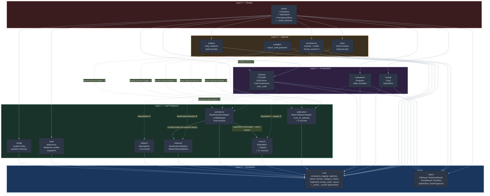
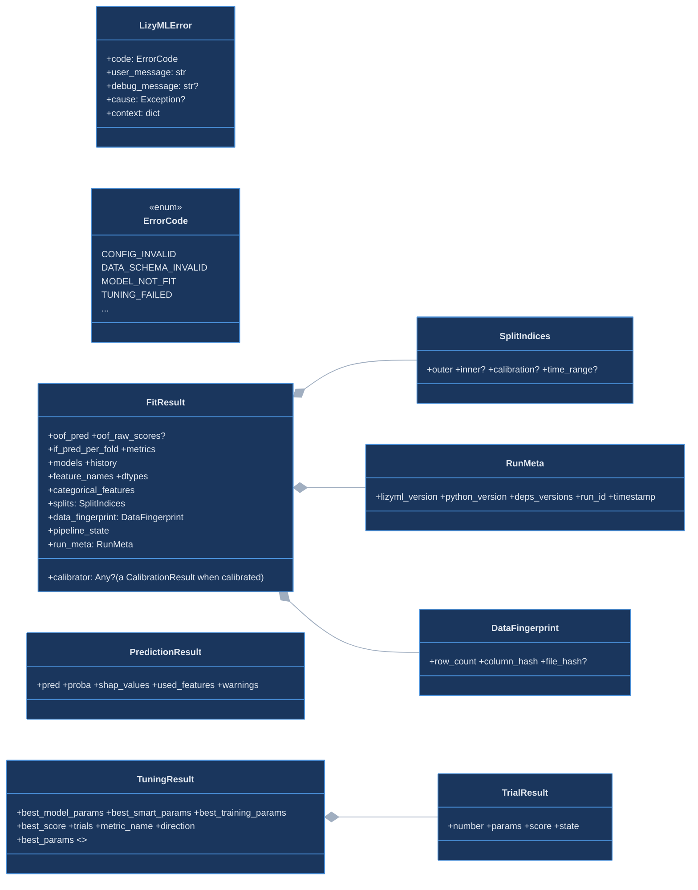
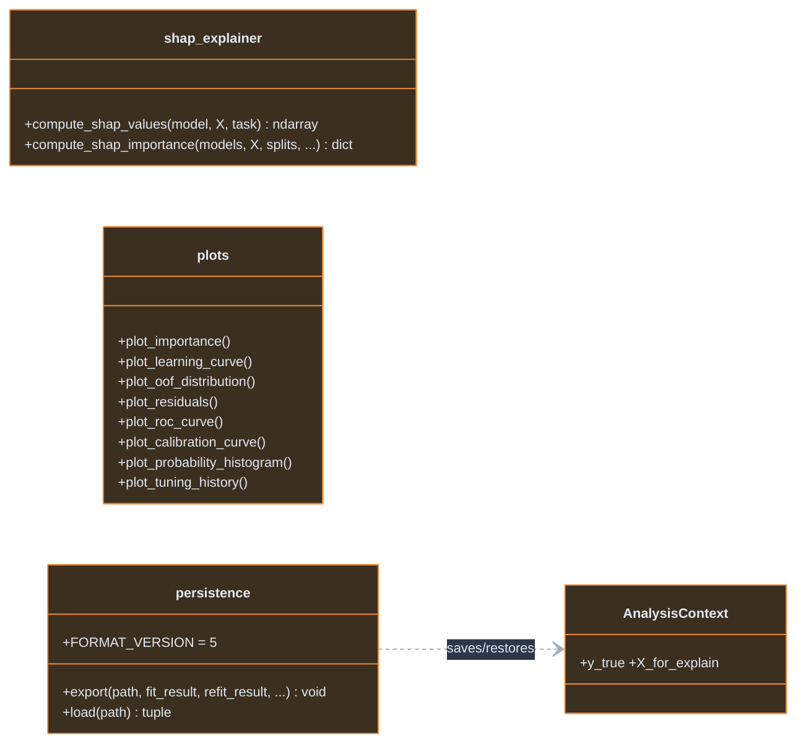
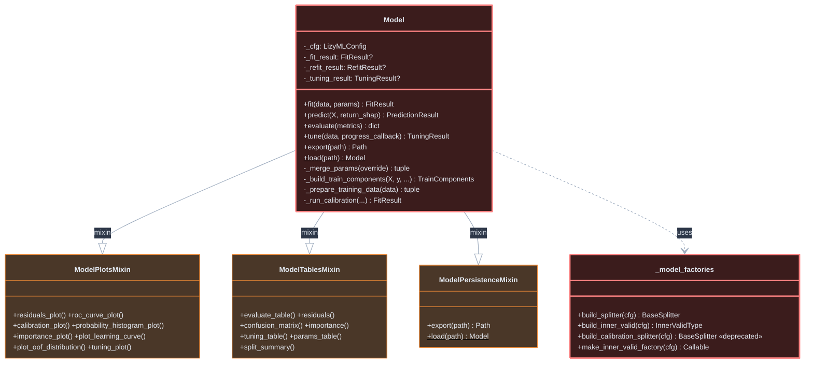

# Architecture

> **この文書は派生文書であり、規範性を持たない（H-0092）。** `BLUEPRINT.md` と実装から
> 書き起こした説明資料で、仕様の正は `BLUEPRINT.md` §0.1 の優先順位に従う。
> 内容が `BLUEPRINT.md` と矛盾する場合は、この文書の側が誤りである。

LizyML のアーキテクチャは **5 層のカテゴリ（圏）** で構成される。
各カテゴリは明確な境界を持ち、依存は上位層→下位層の DAG（非巡回有向グラフ）をなす。同じ層の中の依存は、BLUEPRINT §2.1 の「同じ層の中で許す参照」の表が認める `estimators/` → `features/`・`metrics/` だけ（H-0130）。

## Layer Map — カテゴリ依存 DAG



### 依存ルール

| ルール | 説明 |
|---|---|
| **下方向（と許した同じ層）** | 各カテゴリは、自分より下の Layer と、BLUEPRINT §2.1 の「同じ層の中で許す参照」が認める同じ層のカテゴリ（`estimators/` → `features/`・`metrics/`）にだけ依存する（§2.1 の表と `tests/test_architecture/test_layer_rules.py`、H-0129、H-0130） |
| **IF 経由** | Layer 2 は Layer 1 の**抽象 IF のみ**を参照（具象クラスを import しない）。Layer 3 はそれに加えて Layer 2 の IF（`training/results.py`）を参照してよい |
| **Facade 独占** | 具象の組み立てと具象型ディスパッチ（定義は BLUEPRINT §2.1）は Layer 4 が行う。例外は二つだけ（H-0130）: provider（BLUEPRINT §2.2）が自分の factory で adapter と pipeline を組み、自分の adapter の具象型を扱うこと、各 Layer 1 カテゴリの registry の helper（`metrics/registry.py` の `get_metric`・`get_metrics_for_task`、`calibration/registry.py` の `get_calibrator`）が名前から登録された型を作り、IF として返すこと。テストは静的な import の辺だけを確かめる。H-0131 の実装と、それに対応する architecture のテストが merge されるまで、次の 4 つはレビューだけで守る: (1) 組み立て（Config の型、discriminator の `name`、それから導いた値での選択を含む）、(2) 具象型ディスパッチ、(3) registry の helper を迂回して registry から引くこと、(4) 登録の書き換え（実装のモジュールが自分の型を登録することは許す）（H-0130 改訂 2） |
| **循環禁止** | カテゴリ間の双方向依存は許可しない |

### 射（カテゴリ間契約）

| From | To | 契約 |
|---|---|---|
| Config → Facade | `LizyMLConfig` (validated dict) |
| Data → Facade | `DataFrameComponents(X, y, time_col?, group_col?)` |
| Splitters → Training | `BaseSplitter.split(n, y, groups) → Iterator[(train_idx, valid_idx)]` |
| Features → Training | `BaseFeaturePipeline.fit(X, y)`, `.transform(X) → DataFrame` |
| Estimators → Training | `BaseEstimatorAdapter.fit()`, `.predict()`, `.predict_proba() → ndarray` |
| Metrics → Evaluation | `BaseMetric.__call__(y_true, y_pred) → float`（`needs_train_target` の指標は先に `bind_train(y_train)` で学習側の目的変数に束ねる。H-0132） |
| Calibration → Facade | `BaseCalibratorAdapter.fit(scores, y)`, `.predict(scores) → ndarray` |
| Training → Facade | `FitResult`, `RefitResult` |
| Evaluation → Facade | `dict` (structured metrics) |
| Tuning → Facade | `TuningResult` |

---

## Layer 0 — Foundation

依存ゼロ。全カテゴリが参照する共通基盤。



---

## Layer 1 — Leaf Categories

Foundation に依存する。Layer 1 の中の依存は、BLUEPRINT §2.1 が許す `estimators/` → `features/`・`metrics/` だけ（H-0130）。`RefitResult` は Layer 2（`training/refit_trainer.py`）、`CalibrationResult` は calibration（`calibration/cross_fit.py`）にある。`FitResult.calibrator` の型は `Any | None`。

### config/

```mermaid
%%{init: {'theme': 'base', 'themeVariables': {'fontSize': '11px', 'primaryColor': '#2d3748', 'primaryTextColor': '#e2e8f0', 'lineColor': '#a0aec0', 'background': '#1a202c', 'mainBkg': '#2d3748', 'nodeBorder': '#718096'}}}%%
classDiagram
    direction TB

    class LizyMLConfig:::configClass {
        +config_version: int
        +task: TaskType
        +data: DataConfig
        +features: FeaturesConfig
        +split: SplitConfig
        +model: ModelConfig
        +training: TrainingConfig
        +tuning: TuningConfig?
        +evaluation: EvaluationConfig
        +calibration: CalibrationConfig?
        +output_dir: str?
    }
    class DataConfig:::configClass { +path +target +time_col +group_col }
    class FeaturesConfig:::configClass { +exclude +auto_categorical +categorical }
    class TrainingConfig:::configClass { +seed +early_stopping: EarlyStoppingConfig }
    class EarlyStoppingConfig:::configClass { +enabled +rounds +inner_valid +validation_ratio }
    class EvaluationConfig:::configClass { +metrics: list }
    class CalibrationConfig:::configClass { +method +n_splits‹deprecated› +params }
    class TuningConfig:::configClass { +optuna: OptunaConfig }

    LizyMLConfig *-- DataConfig
    LizyMLConfig *-- FeaturesConfig
    LizyMLConfig *-- TrainingConfig
    LizyMLConfig *-- EvaluationConfig
    LizyMLConfig *-- CalibrationConfig
    LizyMLConfig *-- TuningConfig
    TrainingConfig *-- EarlyStoppingConfig

    %% SplitConfig — discriminated union on "method"
    class KFoldConfig:::configClass { +method="kfold" }
    class StratifiedKFoldConfig:::configClass { +method="stratified_kfold" }
    class GroupKFoldConfig:::configClass { +method="group_kfold" }
    class TimeSeriesConfig:::configClass { +method="time_series" }
    class PurgedTimeSeriesConfig:::configClass { +method="purged_time_series" }
    class GroupTimeSeriesConfig:::configClass { +method="group_time_series" }
    class BlockedGroupKFoldConfig:::configClass { +method="blocked_group_kfold" +blocks +groups }

    LizyMLConfig *-- KFoldConfig : split
    LizyMLConfig *-- StratifiedKFoldConfig : split
    LizyMLConfig *-- GroupKFoldConfig : split
    LizyMLConfig *-- TimeSeriesConfig : split
    LizyMLConfig *-- PurgedTimeSeriesConfig : split
    LizyMLConfig *-- GroupTimeSeriesConfig : split
    LizyMLConfig *-- BlockedGroupKFoldConfig : split

    %% ModelConfig — discriminated union on "name"
    class LGBMConfig:::configClass {
        +name="lgbm"
        +params: dict
        +auto_num_leaves +num_leaves_ratio
        +min_data_in_leaf_ratio +min_data_in_bin_ratio
        +feature_weights +balanced
    }
    LizyMLConfig *-- LGBMConfig : model

    %% InnerValidConfig — discriminated union on "method"
    class HoldoutInnerValidConfig:::configClass { +method="holdout" +ratio +stratify }
    class GroupHoldoutInnerValidConfig:::configClass { +method="group_holdout" +ratio }
    class TimeHoldoutInnerValidConfig:::configClass { +method="time_holdout" +ratio }
    EarlyStoppingConfig *-- HoldoutInnerValidConfig : inner_valid
    EarlyStoppingConfig *-- GroupHoldoutInnerValidConfig : inner_valid
    EarlyStoppingConfig *-- TimeHoldoutInnerValidConfig : inner_valid

    classDef configClass fill:#22543d,stroke:#68d391,color:#e2e8f0
```



### splitters/ + features/ + estimators/ + metrics/ + calibration/ + data/

```mermaid
%%{init: {'theme': 'base', 'themeVariables': {'fontSize': '11px', 'primaryColor': '#2d3748', 'primaryTextColor': '#e2e8f0', 'lineColor': '#a0aec0', 'background': '#1a202c', 'mainBkg': '#2d3748', 'nodeBorder': '#718096'}}}%%
classDiagram
    direction TB

    %% === splitters/ ===
    class BaseSplitter:::ifClass {
        <<abstract>>
        +split(n, y, groups) Iterator
    }
    class KFoldSplitter:::leafClass { }
    class StratifiedKFoldSplitter:::leafClass { }
    class GroupKFoldSplitter:::leafClass { }
    class TimeSeriesSplitter:::leafClass { }
    class PurgedTimeSeriesSplitter:::leafClass { }
    class GroupTimeSeriesSplitter:::leafClass { }
    class BlockedGroupKFoldSplitter:::leafClass { +block_values +cutoffs +mode }
    KFoldSplitter --|> BaseSplitter
    StratifiedKFoldSplitter --|> BaseSplitter
    GroupKFoldSplitter --|> BaseSplitter
    TimeSeriesSplitter --|> BaseSplitter
    PurgedTimeSeriesSplitter --|> BaseSplitter
    GroupTimeSeriesSplitter --|> BaseSplitter
    BlockedGroupKFoldSplitter --|> BaseSplitter

    %% === features/ ===
    class BaseFeaturePipeline:::ifClass {
        <<abstract>>
        +fit(X, y)* +transform(X)*
        +transform_with_warnings(X)
        +get_state()* +load_state()*
    }
    class NativeFeaturePipeline:::leafClass { }
    NativeFeaturePipeline --|> BaseFeaturePipeline

    %% === estimators/ ===
    class BaseEstimatorAdapter:::ifClass {
        <<abstract>>
        +fit() +predict() +predict_proba()
        +predict_raw() +importance()
        +update_params() +get_native_model()
        +best_iteration +eval_results
    }
    class LGBMAdapter:::leafClass {
        -_model: Booster
        +task +params +early_stopping_rounds
    }
    LGBMAdapter --|> BaseEstimatorAdapter

    %% === metrics/ ===
    class BaseMetric:::ifClass {
        <<abstract>>
        +name +needs_proba +needs_simplex +needs_train_target
        +bind_train(y_train) BaseMetric
        +__call__(y_true, y_pred) float
    }
    class MetricRegistry:::ifClass {
        <<IF, metrics/registry.py>>
        +get_metric(name) BaseMetric
        +get_metrics_for_task(names, task) list
    }
    MetricRegistry ..> BaseMetric : builds registered metrics by name (H-0130)

    %% === calibration/ ===
    class BaseCalibratorAdapter:::ifClass {
        <<abstract>>
        +name: str
        +fit(scores, y) +predict(scores)
    }
    class PlattCalibrator:::leafClass { }
    class IsotonicCalibrator:::leafClass { }
    class BetaCalibrator:::leafClass { }
    PlattCalibrator --|> BaseCalibratorAdapter
    IsotonicCalibrator --|> BaseCalibratorAdapter
    BetaCalibrator --|> BaseCalibratorAdapter

    class cross_fit_calibrate:::leafClass {
        +cross_fit_calibrate(oof_scores, y, factory, splits) CalibrationResult
    }
    cross_fit_calibrate ..> BaseCalibratorAdapter : uses via factory
    class BaseCalibrationResult:::ifClass {
        <<marker, calibration/base.py>>
        +calibrated_oof
    }
    class CalibrationResult:::leafClass { +c_final +calibrated_oof +method +split_indices }
    CalibrationResult --|> BaseCalibrationResult
    cross_fit_calibrate ..> CalibrationResult : returns

    %% === data/ ===
    class datasource:::leafClass {
        +read(path) DataFrame
    }
    class dataframe_builder:::leafClass {
        +build(df, problem_spec, feature_spec) DataFrameComponents
    }
    class DataFrameComponents:::leafClass { +X +y +time_col? +group_col? }
    dataframe_builder ..> DataFrameComponents : produces

    classDef ifClass fill:#1e3a5f,stroke:#4a90d9,color:#e2e8f0
    classDef leafClass fill:#22543d,stroke:#68d391,color:#e2e8f0
```



---

## Layer 2 — Composition

Layer 1 の **抽象 IF のみ** を参照。具象クラスを知らない。

```mermaid
%%{init: {'theme': 'base', 'themeVariables': {'fontSize': '11px', 'primaryColor': '#2d3748', 'primaryTextColor': '#e2e8f0', 'lineColor': '#a0aec0', 'background': '#1a202c', 'mainBkg': '#2d3748', 'nodeBorder': '#718096'}}}%%
classDiagram
    direction TB

    %% === training/ ===
    class TrainComponents:::compClass {
        <<frozen dataclass>>
        +estimator_factory: Callable → BaseEstimatorAdapter
        +sample_weight: ndarray?
        +ratio_resolver: Callable?
        +inner_valid: BaseInnerValidStrategy
    }
    class CVTrainer:::compClass {
        +outer_splitter: BaseSplitter
        +inner_valid: BaseInnerValidStrategy
        +pipeline_factory: Callable
        +estimator_factory: Callable
        +task +n_classes +ratio_param_resolver
        +collect_raw_scores: bool
        +fit(X, y, groups, ...) FitResult
    }
    class RefitTrainer:::compClass {
        +inner_valid: BaseInnerValidStrategy
        +pipeline_factory: Callable
        +estimator_factory: Callable
        +task +ratio_param_resolver
        +fit(X, y, groups) RefitResult
    }
    class RefitResult:::compClass { +model +pipeline_state +feature_names +categorical_features +best_iteration +train_pred +history }
    class RefitResultView:::ifClass {
        <<Protocol, training/results.py, Layer 2 IF>>
        the same seven fields (H-0130)
    }
    RefitTrainer ..> RefitResult : returns
    RefitResult ..|> RefitResultView
    class BaseInnerValidStrategy:::ifClass {
        <<abstract>>
        +split(n, y, groups) tuple?
    }
    class NoInnerValid:::compClass { }
    class HoldoutInnerValid:::compClass { +ratio +stratify +random_state }
    class GroupHoldoutInnerValid:::compClass { +ratio +random_state }
    class TimeHoldoutInnerValid:::compClass { +ratio }
    class BlockedGroupInnerValid:::compClass { +ratio }
    class StratifiedTimeHoldoutInnerValid:::compClass { +ratio }
    NoInnerValid --|> BaseInnerValidStrategy
    HoldoutInnerValid --|> BaseInnerValidStrategy
    GroupHoldoutInnerValid --|> BaseInnerValidStrategy
    TimeHoldoutInnerValid --|> BaseInnerValidStrategy
    BlockedGroupInnerValid --|> BaseInnerValidStrategy
    StratifiedTimeHoldoutInnerValid --|> BaseInnerValidStrategy

    TrainComponents ..> CVTrainer : provides factory/resolver/iv
    TrainComponents ..> RefitTrainer : provides same

    CVTrainer o-- BaseInnerValidStrategy : inner_valid

    %% === evaluation/ ===
    class Evaluator:::compClass {
        +task: TaskType
        +evaluate(fit_result, y, metric_names) dict
    }

    %% === tuning/ ===
    class Tuner:::compClass {
        +dims: list~SearchDim~
        +n_trials +direction +timeout +seed
        +progress_callback: TuneProgressCallback?
        +tune(objective, metric_name) TuningResult
    }
    class SearchDim:::compClass {
        <<abstract>>
        +name: str
        +category: model|smart|training
    }
    class FloatDim:::compClass { +low +high +log }
    class IntDim:::compClass { +low +high }
    class CategoricalDim:::compClass { +choices }
    FloatDim --|> SearchDim
    IntDim --|> SearchDim
    CategoricalDim --|> SearchDim
    Tuner o-- SearchDim : dims

    classDef ifClass fill:#1e3a5f,stroke:#4a90d9,color:#e2e8f0
    classDef compClass fill:#2d2040,stroke:#b794f4,color:#e2e8f0
```



**training/ が参照するのは IF のみ:**
- `BaseSplitter` (splitters/)、`BaseFeaturePipeline` (features/)、`BaseEstimatorAdapter` (estimators/)
- 具象クラス (`KFoldSplitter`, `LGBMAdapter` 等) を import しない

---

## Layer 3 — Optional



**依存先**: Foundation と、Layer 1・2 の IF（`estimators/base.py`、`calibration/base.py`、`training/results.py` など。BLUEPRINT §2.1 の表の右の列）。Layer 1/2 の具象を直接参照しない。

---

## Layer 4 — Facade

**唯一**全カテゴリを知る層。具象の組み立てと具象型ディスパッチを担当する（定義は BLUEPRINT §2.1。例外は provider の自分の factory と自分の adapter の型の扱い、registry の helper（`metrics/registry.py`、`calibration/registry.py`）が名前から型を作ること。BLUEPRINT §2.1、H-0130）。



**Facade の責務**: Config などの宣言的な入力を読み、各カテゴリの境界 IF の具象実装を選択・組み立て・接続する（定義は BLUEPRINT §2.1）。
ロジック（OOF 生成、metric 計算、学習ループ等）は一切持たない。

---

## 処理フロー

### fit()

```
Facade (Model)
  │
  ├─ 1. Data ── datasource.read → dataframe_builder.build
  │              → (X, y, groups)
  │
  ├─ 2. Config ── _merge_params(override)
  │              Config defaults < tune best < fit() args
  │              → (model_params, smart_params)
  │
  ├─ 3. Estimators ── resolve_smart_params(dict) → resolved params
  │    Config ── _model_factories.build_inner_valid(cfg)
  │              → TrainComponents (frozen dataclass)
  │
  ├─ 4. Training ── CVTrainer.fit(X, y, groups, ...)
  │    ┌─ Splitters ── outer_splitter.split() → indices
  │    ├─ per fold:
  │    │   ├─ Training ── inner_valid.split(train_fold, y, groups)
  │    │   │              → (inner_train_idx, inner_valid_idx)
  │    │   ├─ Features ── pipeline.fit(X_train) → transform
  │    │   │              ※ pipeline の fit 境界は outer train 全体
  │    │   ├─ Estimators ── estimator.fit(X_inner_train, y_inner_train, X_inner_valid, y_inner_valid)
  │    │   └─ predictions → OOF / IF
  │    └─ → FitResult (metrics={})
  │
  ├─ 5. Calibration ── cross_fit_calibrate(oof_scores, y)
  │              → FitResult + CalibrationResult
  │
  ├─ 6. Evaluation ── Evaluator.evaluate(fit_result, y, metric_names)
  │    └─ Metrics ── registry → BaseMetric.__call__()
  │              → structured metrics dict
  │
  └─ 7. Training ── RefitTrainer.fit(X, y, groups)
                 → RefitResult (final model for inference)
```

### tune()

```
Facade (Model)
  │
  ├─ 1. Data ── _prepare_training_data
  │
  ├─ 2. Config ── _merge_params → base params
  │
  ├─ 3. Tuning ── parse_space or default_space
  │              → list[SearchDim], fixed params
  │
  ├─ 4. Facade builds objective closure:
  │    objective(trial):
  │      ├─ Tuning ── suggest_params → split_by_category
  │      ├─ Estimators ── resolve_smart_params
  │      ├─ Training ── CVTrainer.fit() → FitResult
  │      └─ Evaluation ── Evaluator → score
  │
  ├─ 5. Tuning ── Tuner.tune(objective)
  │              → TuningResult
  │
  └─ stored for next fit()
```

### predict()

```
Facade (Model)
  │
  ├─ 1. Features ── pipeline.load_state → transform_with_warnings
  │
  ├─ 2. Estimators ── model.predict / predict_proba
  │    └─ Calibration ── c_final.predict (binary)
  │
  ├─ 3. Explain ── compute_shap_values (optional)
  │
  └─ → PredictionResult
```

### export() / load()

```
export:  FitResult + RefitResult + Config + AnalysisContext
         (+ TuningResult: trials / rounds / boundary report)
         → metadata.json + fit_result.pkl + refit_model.pkl
           [+ analysis_context.pkl] [+ tuning_history.json (H-0134)]
         format_version=5

load:    metadata.json → validate format_version
         → Model instance (predict / evaluate / plots ready)
```

---

## モジュール構成

```
lizyml/
│
├── core/                           ── Layer 0: Foundation ──
│   ├── exceptions.py               LizyMLError + ErrorCode
│   ├── logging.py                  logger + run_id + output_dir
│   ├── registries.py               MetricRegistry (generic)
│   ├── param_domain.py             受理するパラメーター値の集合 (H-0095; Layer 0, H-0129)
│   ├── category_values.py          保存できるカテゴリ値の閉じた集合と符号化 (Layer 0, H-0133)
│   ├── magnitude.py                探索次元の大きさの検査 (H-0124; Layer 0, H-0134)
│   ├── tuning_codec.py             tune の値・次元・境界の報告・履歴の JSON 符号化 (Layer 0, H-0134)
│   ├── specs/                      ProblemSpec / FeatureSpec など (Layer 0, H-0129)
│   └── types/
│       ├── fit_result.py           FitResult (13 fields)
│       ├── predict_result.py       PredictionResult
│       ├── tuning_result.py        TuningResult, TrialResult
│       ├── artifacts.py            RunMeta, SplitIndices, DataFingerprint
│       ├── task.py / target_encoder.py / search_dim.py
│       ├── oof_coverage.py         compute_oof_valid_mask (H-0130)
│       └── smart_ratio.py          RatioRange, SMART_RATIO_RANGES (H-0130)
│
├── config/                         ── Layer 1: Config ──
│   ├── schema.py                   pydantic schemas (extra="forbid")
│   └── loader.py                   YAML/JSON/dict → LizyMLConfig
│
├── data/                           ── Layer 1: Data ──
│   ├── datasource.py               CSV / Parquet / DataFrame
│   ├── dataframe_builder.py        X/y/groups 分離 + categorical
│   └── fingerprint.py              DataFingerprint 計算
│
├── splitters/                      ── Layer 1: Splitting ──
│   ├── base.py                     BaseSplitter
│   ├── kfold.py                    KFoldSplitter, StratifiedKFoldSplitter
│   ├── group_kfold.py              GroupKFoldSplitter
│   ├── time_series.py              TimeSeriesSplitter
│   ├── purged_time_series.py       PurgedTimeSeriesSplitter
│   ├── group_time_series.py        GroupTimeSeriesSplitter
│   └── blocked_group_kfold.py     BlockedGroupKFoldSplitter (H-0060)
│
├── features/                       ── Layer 1: Features ──
│   ├── pipeline_base.py            BaseFeaturePipeline
│   ├── pipelines_native.py         NativeFeaturePipeline
│   └── encoders/
│       ├── categorical_encoder.py  CategoricalEncoder
│       ├── category_identity.py    構造のキーでのカテゴリの学習と照合 (H-0138)
│       └── state_changes.py        保存処理で写した状態と元の状態の比較 (H-0136)
│
├── estimators/                     ── Layer 1: Estimators ──
│   ├── base.py                     BaseEstimatorAdapter
│   ├── provider.py                 EstimatorProvider protocol (H-0053)
│   └── lgbm/                       LightGBM subpackage (H-0053)
│       ├── adapter.py              LGBMAdapter (Booster API wrapper)
│       ├── defaults.py             Task defaults, search space
│       ├── smart_params.py         resolve_smart_params, resolve_ratio_params
│       ├── metric_bridge.py        Metric mapping, validation, feval (H-0064)
│       └── provider.py             LGBMProvider (EstimatorProvider impl)
│
├── metrics/                        ── Layer 1: Metrics ──
│   ├── base.py                     BaseMetric
│   ├── registry.py                 MetricRegistry helpers
│   ├── regression.py               RMSE, MAE, R2, RMSLE, MAPE, Huber
│   └── classification.py           LogLoss, AUC, AUCPR, F1, Accuracy, Brier, ECE
│
├── calibration/                    ── Layer 1: Calibration ──
│   ├── base.py                     BaseCalibratorAdapter + BaseCalibrationResult (marker, H-0130)
│   ├── cross_fit.py                cross_fit_calibrate + CalibrationResult
│   ├── registry.py                 get_calibrator
│   ├── platt.py                    PlattCalibrator
│   ├── isotonic.py                 IsotonicCalibrator
│   └── beta.py                     BetaCalibrator
│
├── training/                       ── Layer 2: Training ──
│   ├── cv_trainer.py               CVTrainer (outer CV loop)
│   ├── refit_trainer.py            RefitTrainer + RefitResult
│   ├── results.py                  RefitResultView (Protocol, Layer 2 IF, H-0130)
│   ├── oof_assembly.py             fill_oof / get_fold_pred (+ compute_oof_valid_mask を再公開)
│   ├── train_components.py         TrainComponents (frozen dataclass)
│   └── inner_valid.py              BaseInnerValidStrategy + 6 concrete
│
├── evaluation/                     ── Layer 2: Evaluation ──
│   ├── evaluator.py                Evaluator (structured metrics)
│   ├── table_formatter.py          evaluate_table 整形
│   └── confusion.py                confusion_matrix_table
│
├── tuning/                         ── Layer 2: Tuning ──
│   ├── tuner.py                    Tuner (Optuna study management)
│   └── search_space.py             SearchDim, parse/suggest/split_by_category
│
├── explain/                        ── Layer 3: Explain (optional) ──
│   └── shap_explainer.py           compute_shap_values / importance
│
├── plots/                          ── Layer 3: Plots (optional) ──
│   ├── importance.py               feature importance bar chart
│   ├── learning_curve.py           training/validation loss curve
│   ├── oof_distribution.py         OOF prediction distribution
│   ├── residuals.py                scatter/histogram/QQ
│   ├── classification.py           ROC curve
│   ├── calibration.py              reliability diagram + probability histogram
│   └── tuning.py                   tuning history plot
│
├── persistence/                    ── Layer 3: Persistence ──
│   ├── exporter.py                 export() + FORMAT_VERSION
│   ├── loader.py                   load() + format_version validation
│   ├── _manifest.py                checksums の形の検査 declared_files (H-0135)
│   └── _category_preflight.py      書く前のカテゴリの検査 (H-0136)
│
├── codegen/                        ── Layer 3: Codegen (optional, H-0059/H-0073) ──
│   ├── generator.py                generate_code() (Model.export_code から)
│   ├── artifact_writer.py          pipeline_state.json / model.txt 書き出し
│   ├── config_writer.py            config.json 書き出し
│   ├── identity_template.py        生成コードに写すカテゴリの同一性 (H-0138)
│   └── templates.py                train.py / predict.py / test_equivalence.py テンプレ
│
└── core/                           ── Layer 4: Facade ──
    ├── model.py                    Model (組み立てと委譲のみ)
    ├── _model_factories.py         splitter/inner_valid/calibration 構築
    ├── _model_metrics.py           metric filtering + calibrated assembly
    ├── _model_predict.py           predict/calibration/SHAP 本体 (#172)
    ├── _model_state.py             FitState / TuningState (facade snapshot, #171)
    ├── _model_plots.py             ModelPlotsMixin
    ├── _model_tables.py            ModelTablesMixin
    └── _model_persistence.py       ModelPersistenceMixin
```

---

## 凡例

| 色 | Layer | 意味 |
|---|---|---|
| 青 | 0 | **Foundation** — 全カテゴリが参照する型・例外・ログ |
| 緑 | 1 | **Leaf** — Foundation に依存する独立カテゴリ（同じ層の依存は §2.1 が許す `estimators/` → `features/`・`metrics/` だけ） |
| 紫 | 2 | **Composition** — Layer 1 の IF を組み合わせるカテゴリ |
| 橙 | 3 | **Optional** — Foundation と Layer 1・2 の IF を参照する追加機能 |
| 赤 | 4 | **Facade** — 唯一全カテゴリを知り、組み立てる（例外: provider の factory と自分の adapter の型の扱い、registry の helper（`metrics/registry.py`・`calibration/registry.py`）） |

---

## 実装状況

### H-0051/H-0052/H-0053（完了 ✅）

以下の移行作業はすべて完了済み:

| # | 問題 | 修正内容 | 状態 |
|---|---|---|---|
| 1 | `training/` → `evaluation/oof.py` 依存 | `oof.py` を `training/oof_assembly.py` に移動（H-0052） | ✅ 解消 |
| 2 | `evaluation/` → `calibration/` 依存 | calibrated metrics 組み立てを Facade に移動（H-0052） | ✅ 解消 |
| 3 | `estimators/` → `config/` 依存 | `extract_smart_params` を LGBMProvider に移動（H-0053） | ✅ 解消 |
| 4 | `types/` → `data/` 逆依存 | `DataFingerprint` を `core/types/artifacts.py` に移動（H-0051） | ✅ 解消 |
| 5 | `splitters/` ↔ `specs/` 循環 | 死んだ Spec 層を削除（H-0051） | ✅ 解消 |
| 6 | デッドコード多数 | 8 ファイル + Registry + Spec 変換関数を削除（H-0051） | ✅ 解消 |

### H-0054: EstimatorProvider 完全化（作業中）

2つ目のアルゴリズム追加を阻む残存 LGBM 固有依存:

| # | 問題 | Layer ルール違反 | 修正方針 |
|---|---|---|---|
| 1 | `estimators/provider.py` が `tuning/search_space.py` の `SearchDim` を import | L1 → L2 逆依存 | `SearchDim` 型を `core/types/search_dim.py` に移動 |
| 2 | `cv_trainer.py` に `categorical_feature=` kwarg 直書き | L2 に LGBM 固有知識 | `BaseEstimatorAdapter.set_categorical_features()` に移動 |
| 3 | `_model_tables.py` が `LGBMConfig` を isinstance チェック | Facade に LGBM 具象依存 | `EstimatorProvider.params_summary()` 経由に |
| 4 | `_build_run_meta` に `"lightgbm"` ハードコード | Facade に LGBM 文字列 | `EstimatorProvider.runtime_deps()` 経由に |
| 5 | `shap_explainer.py` が `NativeFeaturePipeline` を直 import | L3 → L1 具象依存 | `pipeline_factory` を引数で受け取る。✅ 解消（H-0130: `pipeline_factory` を必須にし、代わりの経路を消した） |

### H-0088: 宣言済み横断エッジ（#211 — 循環なし・型移動は follow-up）

以下は H-0088 で仕様に明示宣言した、循環のないエッジ。1〜3 行目は H-0130 で解消し、今は層の規則のテスト（`tests/test_architecture/test_layer_rules.py`）が全ての import を確かめる。4 行目は層の import の問題ではなく、残る。

| # | 実在エッジ | 種別 | 解消方針（follow-up） |
|---|---|---|---|
| 1 | `evaluation/{evaluator,confusion}.py` → `training/oof_assembly.compute_oof_valid_mask` | L2 内の横依存（純粋な split-mask utility, H-0052 副作用） | ✅ 解消（H-0130: `core/types/oof_coverage.py` へ移し、`training/oof_assembly.py` は再公開） |
| 2 | `persistence/exporter.py` → `training.refit_trainer.RefitResult`（TYPE_CHECKING のみ） | L3 → L2 型参照（実行時依存なし） | ✅ 解消（H-0130: exporter は Layer 2 の IF `training/results.RefitResultView` で注釈。`RefitResult` は pickle の名前を保つため動かさない） |
| 3 | `plots/calibration.py` → `calibration.CalibrationResult`（runtime import + isinstance dispatch） | L3 が L1 具象を型ディスパッチ（H-0054 item 5 と同種） | ✅ 解消（H-0130: plots は `calibration/base.BaseCalibrationResult` の目印で判定。`CalibrationResult` は動かさない） |
| 4 | `codegen/` の estimator 固有 seam（`generate_code(..., lgbm_params=...)`） | H-0073 の estimator-agnostic 目標と不整合 | `ExportParams` / provider metadata 経由へ一本化、`templates.py` 分割（[#228](https://github.com/nbx-liz/LizyML/issues/228)） |
